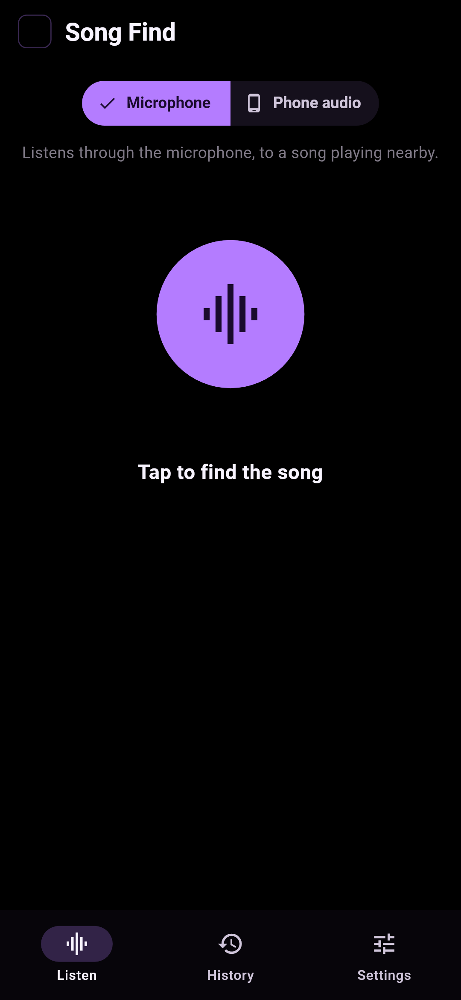
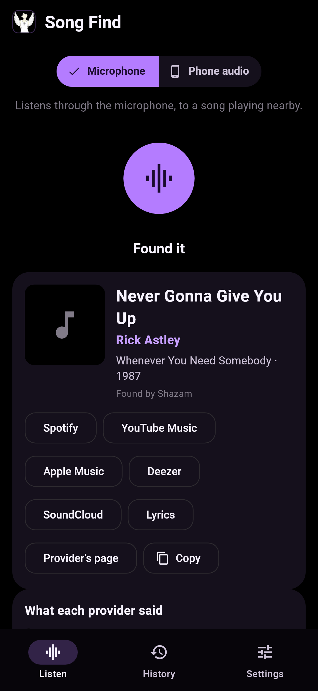
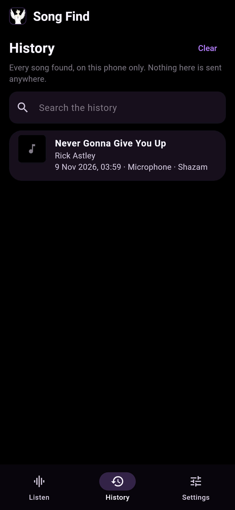

# Noctorium Song Find for Android

Which song is playing? Noctorium Song Find listens and tells you — like Shazam, as part of Noctorium. It is
the phone's half of a pair; the desktop's is
[Noctorium-song-find-desktop-rust](https://github.com/Noctorium/Noctorium-song-find-desktop-rust).

Written in Dart with Flutter, for Android 8.0 and later.

<p align="center">
  
  
  
</p>

## Two ways to listen

- **Microphone** — a song playing nearby: a speaker, a shop, a car.
- **Phone audio** — what the phone itself is playing: a video, a stream, a game, another app. Android asks
  first (it is the same question as for screen recording, though only sound is recorded), and shows a
  notification for the few seconds it lasts. Needs Android 10 or later. Apps that forbid capture of their
  sound — some streaming apps do — cannot be heard this way.

## Providers

Asked in the order you put them in Settings, until one knows the song — or all of them, if you prefer:

| Provider | What it needs | What is sent |
| --- | --- | --- |
| **Shazam** | nothing | a fingerprint of the sound, never the sound itself |
| **AudD** | nothing for a few tries a day; an API token from [audd.io](https://dashboard.audd.io/) for more | a few seconds of the sound |
| **ACRCloud** | a project's host, access key and secret, free at [console.acrcloud.com](https://console.acrcloud.com/) | a few seconds of the sound |

Shazam is asked the way its own Android app asks, with the fingerprint algorithm
[SongRec](https://github.com/marin-m/SongRec) worked out (GPL-3.0, like this), written here in Dart
(`lib/signature.dart`). It is not an official, documented service, so it may change without warning.
AcoustID, which wants a fingerprint of a whole song from a file, is on the desktop app.

Every song found links to Spotify, YouTube Music, Apple Music, Deezer and SoundCloud, and to its lyrics.

## History

Every song found is kept in a history **on this phone only**, searchable, with each entry removable and a
button to clear it all; Settings can turn it off. Backups are off for this app, so it is not copied anywhere
either.

## Updates

At start the app asks GitHub whether a newer Noctorium release is out, as every Noctorium does, and offers
it in a line at the top. **Install** downloads `Noctorium-Song-Find-<version>.apk`, checks it against the
SHA-256 GitHub publishes for it, and hands it to Android's own installer, which asks before it replaces
anything. Settings › Updates turns the check off.

## Getting it

- Every Noctorium release carries `Noctorium-Song-Find-<version>.apk` on
  [the releases page](https://github.com/Noctorium/Noctorium-Installer/releases/latest), signed with the
  same key as Noctorium. It installs beside Noctorium as `app.noctorium.songfind`.
- The Noctorium phone installer offers it.
- **[Obtainium](https://github.com/ImranR98/Obtainium):** add the source
  `https://github.com/Noctorium/Noctorium-Installer`, and set *Filter APKs by regular expression* to
  `Noctorium-Song-Find-.*\.apk`.

## Building

With Flutter 3.47.9 and a Java 17 or newer:

```bash
flutter pub get
flutter analyze
flutter test                     # every test, the screenshots included
flutter build apk --debug        # build/app/outputs/flutter-apk/app-debug.apk
```

A debug build is `app.noctorium.songfind.debug`, called *Noctorium Song Find (debug)*, so it installs beside
a released one.

`dart run tool/identify.dart <file>` runs the phone's own fingerprinting and providers on a computer, against
the real services, for a raw 16 kHz mono 16-bit recording
(`ffmpeg -i song.mp3 -ac 1 -ar 16000 -f s16le song.pcm`).

`test/golden_test.dart` draws every screen into `test/goldens/`:
`flutter test --update-goldens --tags golden`. CI runs `flutter test --exclude-tags golden`, since Linux
draws text a pixel differently.

## Releasing

Noctorium-Installer's release workflow builds this repository at the release tag `vX.Y.Z`, as it does
Noctorium Stats'. `--build-name` is the version and `--build-number` packs it as
`major * 10000 + minor * 100 + patch`.

## Licence

GPL-3.0-only, as the rest of Noctorium.
